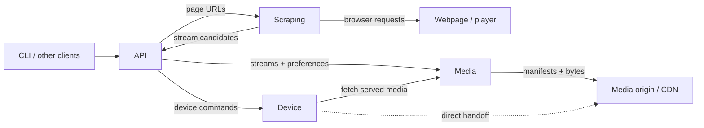
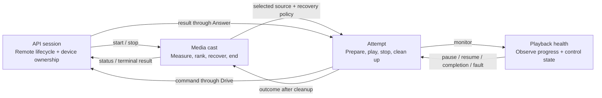
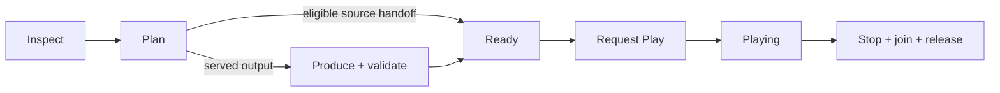

# Architecture

Castor ships three independent services in one binary. They can run embedded or remotely through the same Connect/protobuf contracts.

## Services and ownership

| Owner | Responsibility | Contract |
| --- | --- | --- |
| Clients | Catalog, source selection, UI | `castor.v1` |
| API | Device discovery/control, preferences, orchestration, public status | `castor.v1` |
| Scraping | Chrome, frames, stream discovery and replay headers | `castor.scraping.v1` |
| Media | Source selection, probing, ranking, encoding, subtitles, delivery and recovery | `castor.media.v1` |

Scraping discovers stream URLs from webpages. Media receives those URLs and fetches their manifests and bytes. Direct streams bypass scraping; candidate lists are ranked and retained for recovery. One candidate can contain multiple HLS/DASH renditions.

Services share generated contracts from [`proto/`](proto/), validated at RPC boundaries. Consumers define narrow ports; service entry points wire adapters, and binary main composes services. Domain implementations stay within each service's `internal` packages. Shared plumbing owns configuration, authentication and telemetry. Only media requires cgo for Whisper.

Android composes API and media inside an app-owned native process. An authenticated loopback adapter supplies WebView extraction and Android device discovery using the public contracts. API owns device control; media owns ranking, delivery, transcoding and subtitles. See [Android](android/README.md).

## Cooperating state machines

API creates a cast ID, connects the device, resolves pages and starts media. It opens `Watch` for status and `Drive` for device commands; command results return through `Answer`. Media makes playback decisions while API executes device operations on the device's network. The same cast ID follows RPCs and logs.

Each machine owns its transitions and accepts typed events. The cast runs attempts sequentially: recovery can revise delivery or choose another candidate only after the previous attempt has finished cleanup. Health observes and proposes actions; the attempt applies them and reports command outcomes.

Within an attempt, operations return typed inputs for the next stage:

Only a certified ready presentation can request Play. Cancellation or failure from any active stage enters cleanup. The attempt joins preparation, producers and active delivery requests before releasing storage. API joins its Watch and Drive workers before releasing the device. A cast belongs to API independently of UI connections; each service drains its own work on shutdown.

## Media contracts

The engine separates what a source declares, what was observed, and what output must preserve:

| Evidence | Meaning |
| --- | --- |
| `Declaration` | A manifest's codec and rendition envelope; cannot establish successful probing or track absence. |
| `Observation` | Probe facts bound to the inspected URLs, formats, headers, representations, selected tracks and clock. Changed bindings invalidate reuse. |
| `TrackRequirements` | Tracks the output must retain, derived from mandatory selections and positive source evidence. |

- **Source adapters own format details.** HLS/DASH adapters resolve manifests, select resources and decode their envelopes. A shared relay handles bounded reads, caching and timeline publication. Core orchestration works with normalized programs and capabilities.
- **Planning uses measured media.** Ranking summaries remain separate from bound observations. Republishing under a local URL requires inspecting that reading; output validation retains the original program's track requirements.
- **Track choices are explicit.** Every track is copied, encoded or omitted. An unfinished plan cannot build an FFmpeg command. Stream presence is separate from codec parameters: an unidentified stream is present and cannot silently disappear.
- **Readiness follows the delivery path.** Direct handoff requires source/receiver eligibility. Served output requires an available, validated artifact. Output adapters own packaging and publication; capability checks govern compatibility. Live-source evidence describes observed media and cannot guarantee future segments.
- **Failures remain observable.** Readiness does not end monitoring: reader, producer and playback failures feed the attempt outcome and cast recovery.

## Deployment and trust

API runs where it can reach devices; scraping runs with Chrome; media runs where devices can fetch its published URLs. Standalone commands start only their own service. See [README.md](README.md) for configuration.

Services use independent bearer tokens. Health checks and device-facing `/media` routes are open; publications use random paths and closing them joins active requests. Replay headers reach media but are stripped from public listings. See [SECURITY.md](SECURITY.md).
